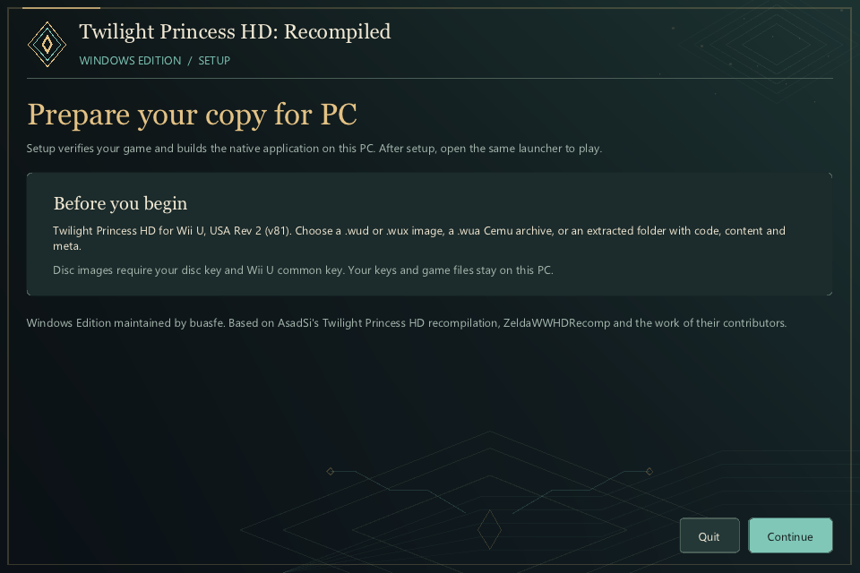
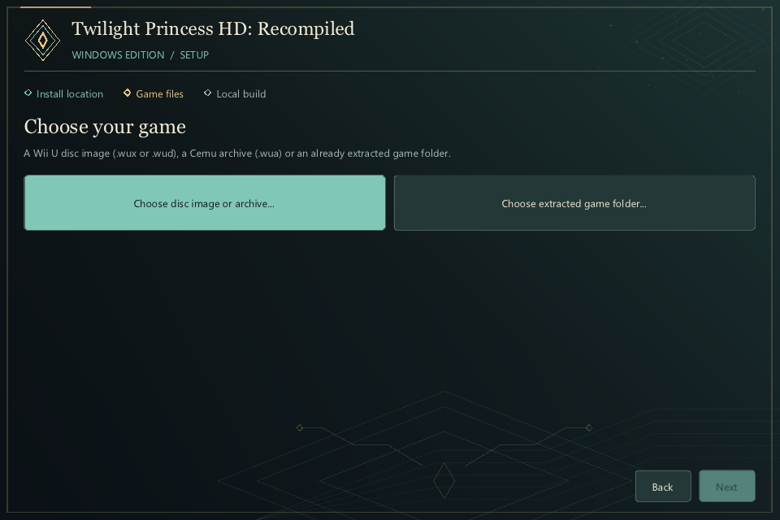
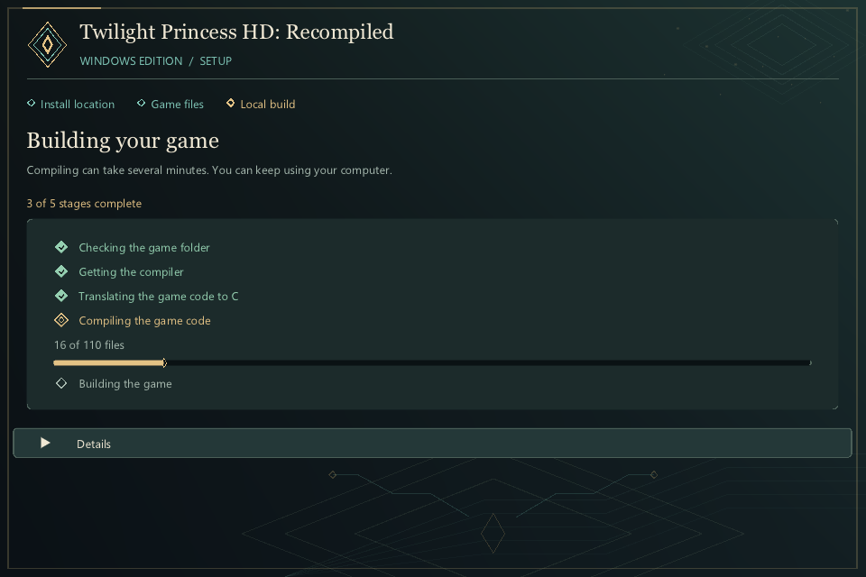

# Twilight Princess HD: Recompiled — Windows Edition

Windows Edition is a native Windows x86-64 Vulkan recompilation maintained by [buasfe](https://github.com/buasfe). It builds on [AsadSi’s Twilight Princess HD recompilation](https://github.com/AsadSi/twilight-princess-hd-recomp) and the [ZeldaWWHDRecomp](https://github.com/ZeldaWWHDRecomp/ZeldaWWHDRecomp) recompiler, Cafe OS runtime and graphics infrastructure. Setup verifies and translates the Wii U executable from your own game dump, then links it with the native runtime on your PC.

The published [20th Anniversary Preview](https://github.com/buasfe/twilight-princess-hd-recomp-windows/releases/tag/v0.1.0-windows-preview.1) is a source-only release. This page also tracks newer development source and the private builds used to test it. Follow the [Windows build guide](docs/windows.md) to build from source.

## Windows setup

The themed setup app guides you through choosing an install location and game files, checking the Vulkan driver, and compiling the game with the pinned LLVM-MinGW toolchain. The same launcher opens the installed game. Setup can also repair an installation or import a compatible Wii U or Cemu save, with a backup of an existing save on import. The installer theme and emblem were made for this project.

| Choose your game files | Follow local build progress |
| --- | --- |
|  |  |

These screenshots show the installer used during development. When a setup build is released, look under [Releases](https://github.com/buasfe/twilight-princess-hd-recomp-windows/releases) for an explicitly named **TwilightPrincessHD-Windows-Setup-x64.zip** asset. GitHub’s **Source code (zip)** is for building from source.

## Development progress

| Area | Implementation and verification |
| --- | --- |
| Windows and saves | The anniversary build was tested on Windows 11 with Vulkan, audio, save and reload, and Ordon gameplay, including 21:9 and 2× internal resolution. Later isolated installs generated, compiled and linked USA Rev 2 game code with the checksum-verified compiler. Launcher detection and a Vulkan smoke test passed on the final private integration package. |
| Controllers and button prompts | Xbox Series input was tested in Wii U GamePad and Pro Controller modes. F1 **Controls** manages controller mode, bindings, dead zones and prompt style. The controller fixes cover reconnects, input after closing F1 and idle menu scrolling. Binding-aware Xbox, PlayStation and Original Wii U prompts were visually checked in the Ordon HUD and Quest Log. Tests cover custom bindings and hotplug policy. Physical DualSense Auto detection and broader prompt coverage still need hardware and gameplay checks. |
| 60 FPS HUD and animation | In Windows/Vulkan previews, dialogue glow remained steady and Epona’s spur icons stayed in place. A later preview confirmed the reins no longer jumped between 60 FPS frames, with the original occasional clipping still visible. The 60, 120 and 240 FPS options interpolate presentation from the original 30 Hz gameplay clock. |
| Ultrawide UI | The 21:9 dialogue glow and the farmer’s Yes/No selection markers were visually verified. The latest shared selection-coordinate change covers the Collection grid and startup controller selector, with focused tests for cursor anchors. A full visual pass across menus and additional aspect ratios remains open. |
| Title-screen cinematics | Isolated previews exercised the HD opening, the original GameCube trailer from a local ISO, the return to the HD opening and controller skipping. Optional local HD video playback was also visually checked for picture and audio sync. The final private package was checked headlessly for installation and decoding. Automatic playback in that exact build still needs an in-game check. |

The shared ultrawide selection change is included in this source. The intermittent white flash in the forest remains a known issue. Hardware and full-game progression coverage are limited.

## Game files and compatibility

- The supported input is **Twilight Princess HD for Wii U, USA Rev 2 (v81)**, title ID `00050000-1019E500`. Setup accepts an extracted folder containing `code/Zelda.rpx`, `content/` and `meta/`, a compatible Cemu `.wua` archive, or a `.wud` or `.wux` disc image. Use individual local disc and common-key files for encrypted images. Multi-entry Cemu `keys.txt` import is unsupported. The final private installation check used an extracted folder. Other regions, revisions and update combinations remain outside the tested game inputs.
- Windows testing targets x86-64 with a Vulkan 1.3 driver or Vulkan 1.1/1.2 with `VK_KHR_dynamic_rendering` and the required dependencies. Use Setup’s **Check Vulkan compatibility** on laptops and dual-GPU machines. The [Windows build guide](docs/windows.md) has the source-build requirements.
- When using a setup package, extract the entire ZIP into a writable folder and open **Twilight Princess HD.exe**. The default install is `data/` beside the launcher. Hold **Shift** while reopening the launcher, or pass `--setup`, to access repair, install location and save import. Keep a separate installation and save directory for testing.
- F1 **Controls → Button prompts** offers Auto and manual styles. Auto uses the detected controller family. Virtual controllers can report a different family, so select PlayStation or Xbox explicitly when needed. [Controller prompt notes](docs/button-glyphs-development.md)
- F1 **Display → Title cinematics** accepts a locally supplied USA GameCube ISO or video and uses a local FFmpeg executable. The optional trailer plays after the HD opening and returns to it after playback. Clear both selections to restore the stock HD loop. The source and public release contain the playback code only. [Cinematic configuration](docs/title-attract-movie.md)

## Build from source

1. Follow the [Windows build guide](docs/windows.md) to prepare Vulkan headers, LLVM-MinGW, CMake, Ninja and Python, then build and run the placeholder runtime tests.
2. Verify your extracted USA Rev 2 game folder and use the guide to generate and compile the native executable locally.
3. Launch with `--game` pointing at the extracted folder. Use `--save` to keep your test saves separate.

Keep game files, keys, generated code, linked game executables, saves and optional media local. See the [setup packaging guide](docs/windows-setup-release.md) for the game-free build process.

## Issues and credits

When reporting a problem, include the source revision, Windows version, GPU and driver, controller mode, resolution and steps to reproduce. For rendering issues, include the presentation rate and whether the issue also occurs at 30 FPS. Redact local paths and credentials from logs.

Windows development has used extensive AI-assisted coding alongside hands-on testing and debugging by the maintainer. The project is unofficial. Project source is under the [Mozilla Public License 2.0](LICENSE). Vendored dependencies retain their own licence notices. See the [upstream and contributor credits](CREDITS.md).
